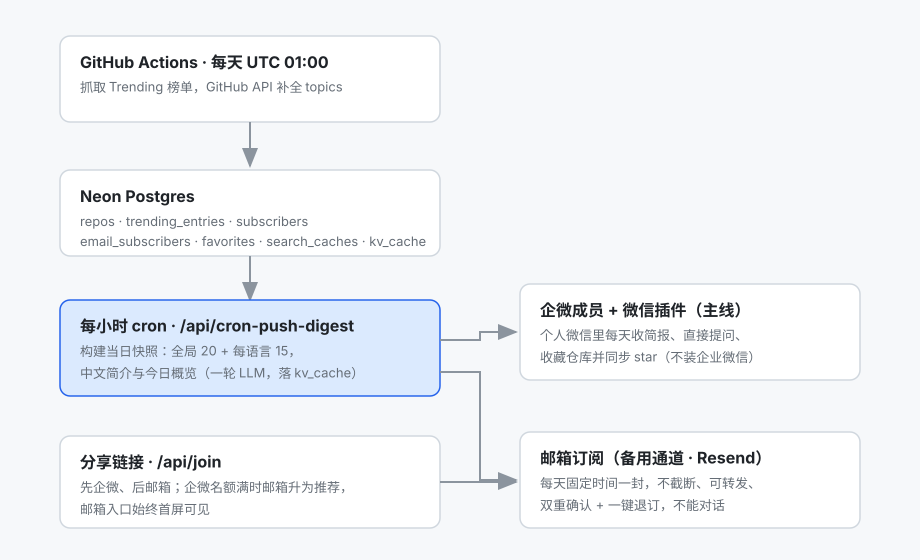
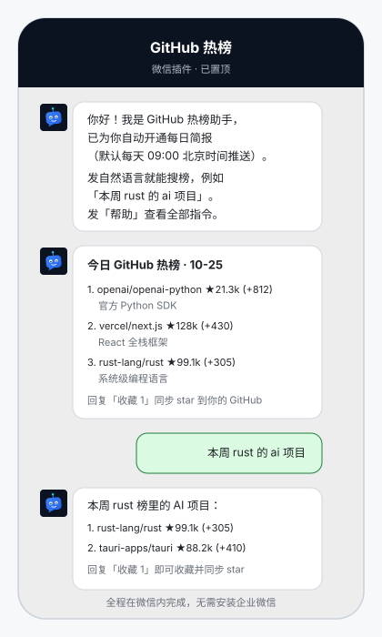
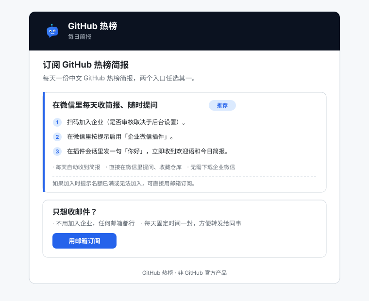
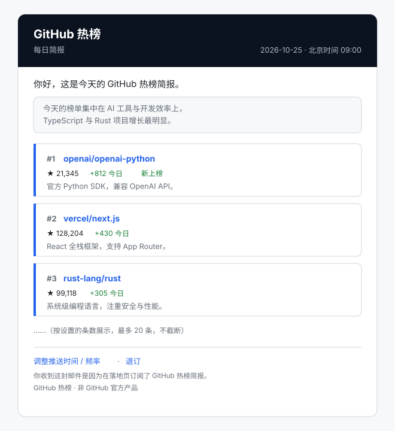

<!-- profile-agent:readme:start -->
🇨🇳 [中文](README.md) · 🇺🇸 [English](README.en.md)
基于企业微信自建应用实现对话式 GitHub Trending 检索 Agent：GitHub Actions 每日抓取热榜并调用 GitHub 官方 API 补全 topics 标签，聊天窗口内支持自然语言检索、收藏与取消收藏（同步 star 到 GitHub 账号）。

- **每日热榜抓取与补全**：`.github/workflows/daily.yml` 每天 UTC 00:30（北京时间 08:30）跑 `src/scraper/run-scraper.ts` 抓取 Trending 页面入库，随后 `src/github/run-enrich.ts` 调 GitHub 官方 API 补全 topics 标签（**先入库、后补全**）
- **双模式交互与查询解析缓存**：被动定时推送 top10 简报（LLM 故障时降级为纯模板，仓库列表始终送达）；主动发送自然语言（如「本周 rust 的 ai 项目」）由 `src/agent/parse-query.ts` 解析查询条件进行多维度过滤；`src/agent/query-cache.ts` 对解析结果做 30 天缓存，key 带 `parse:v1:` 版本前缀，命中时不调用模型，过期、坏值或读库失败均按未命中处理
- **OAuth 收藏同步与最近检索缓存**：`src/github/oauth.ts` 完成 GitHub 授权（scope 仅 public_repo）后，可在聊天中「收藏 N / 取消收藏 N」，自动同步 star 到用户账号，并支持「我的收藏」列表；`src/agent/recent-results.ts` 抽出最近一次检索缓存，供「收藏 N」与「感兴趣/不感兴趣」共用，并区分「没搜过」与「搜过但结果为空」
- **企业微信接入完整、双触达渠道**：`src/wecom/crypto.ts` 实现回调加解密，`src/wecom/router.ts` 分发指令（搜索、收藏、绑定、订阅偏好、退订、帮助），`src/wecom/onboarding.ts` 首条消息自动开通订阅；用户在个人微信里启用「企业微信插件」即可每天收简报并直接提问（无需安装企业微信 App）；`/api/join` 落地页提供企微加入引导 + 邮箱备用入口（Resend，双重确认、不截断、可退订）
- **数据与工程化**：Drizzle ORM + SQL 迁移（`drizzle/`）管理用户、订阅、搜索结果、收藏与运行日志；请求级 trace 与工具调用流水落 `agent_runs` / `tool_calls`，`/api/metrics` 报出成功率、延迟分位、路由分布与 token 用量；`evals/` 98 条金标 + CI 回归门禁，规则改坏会让流水线变红；`tests/` 覆盖解析、检索、回调、加解密、查询缓存、最近检索等核心逻辑的 Vitest 用例

部署与联调步骤见 [docs/deploy.md](docs/deploy.md)。
<!-- profile-agent:readme:end -->

<p align="center">
  
</p>

基于企业微信自建应用的对话式 GitHub Trending Agent。GitHub Actions 每日抓取热榜并调用 GitHub 官方 API 补全 topics 标签；支持被动定时简报与自然语言主动检索（规则前置 + LLM 解析，模型只在规则未命中时参与）。用户授权后可在聊天窗口收藏仓库并同步 Star；支持查看、取消收藏，以及长期背景记忆、每周复盘与工具调用。

---

## 架构一览



一句话：**抓取和翻译只做一次，两个渠道共用同一份当日快照**——企微按 1900 字节截断（文本上限 2048 字节）、邮箱不截断，个性化只是在内存里按偏好挑不同的行，不额外调用模型。

## 使用说明（企业微信）

**这是什么**：GitHub Actions 每日抓取 GitHub Trending 并补全 topics 标签；企业微信里既能被动接收每日简报，也能主动用自然语言检索热榜；用户授权 GitHub 后可直接在聊天中收藏仓库并同步 star 到自己的账号，支持查看与取消收藏。

在企业微信（或微信中的「企业微信插件」）里向应用发送：

- **自然语言搜索**：「本周 rust 的 ai 项目」→ 返回编号列表，末尾提示按序号收藏
- **收藏 N / 取消收藏 N**：「收藏 N」按最近一次搜索列表的序号收藏，「取消收藏 N」按「我的收藏」列表的序号取消，均同步 GitHub star（需先「绑定」）
- **我的收藏**：查看已收藏的编号列表
- **绑定**：回复 GitHub 授权链接（scope 仅 public_repo），浏览器完成授权即绑定
- **订阅偏好**：如「订阅 python,ai」；只发「订阅」时会追问一个关键词（5 分钟内回一个词即可）
- **退订**：停止每日简报（GitHub 绑定与收藏不受影响；再次发「订阅 python,ai」即可恢复）
- **长期记忆**：「记住 我是做 Agent 开发的」让回答更贴合你；「我的记忆」查看、「忘掉 <词>」删除、「忘掉 全部」清空（只影响措辞，不参与推不推送）
- **工具调用**：发「深挖 owner/repo」「这个项目靠不靠谱」时，模型可自己调用仓库详情、项目健康度等工具；普通搜索**不进工具链**——没配 key 时完全不调模型，配了也只做一次查询解析
- **帮助**：查看用法说明

**每周复盘**：每周一 10:00 后，给这周有推送/收藏/反馈的用户发一条「收到多少、收藏多少、下周多推/少推什么」；有明确口味信号时会问一句「要我记住吗」，回「对」写入记忆、回「不」跳过。零动静的账号不发。

**今日观察**：每天生成 2–3 条判断（说明「社区今天在集中解决什么」），写入当日归档，**不在微信里单独推送**——在「我的面板 → 历史」里回看。事实由 7 天 `trending_entries` 与多源（HF / GitHub 搜索）计算（新上榜、加速、连续在榜、主题变化、跨源首次收录），模型只负责把事实写成完整的一句话；数字与仓库名都做白名单校验。与过去 7 天的观察做签名/证据去重；**模型写不出判断、或没有真正的新主题时当天不生成**，宁可安静也不发数字堆叠。

**数据源**：GitHub Trending（主榜）+ Hugging Face 模型/Space + GitHub 近 7 天新仓库；Hacker News / Lobsters 也在每日入库，观察层暂不读取，先积累数据评估噪音。

**控制面板**：微信里发「我的面板」获取一条 7 天有效的 H5 链接，可暂停/恢复推送、增删跟踪、收藏/取消收藏、增删记忆、修改推送时间/条数/间隔/语言/关键词、回看历史简报，并一键进入模型 Key 设置页。总览 hero 侧边还有一个可捏的 SVG 小机器人：每天一颗日贴纸、一颗天气贴纸环绕它；天气按网络位置（城市可改，Open-Meteo）。写操作与聊天命令共用同一套服务层（`mergePreferences`、`tracking-service`、`favoriteRepo`、`rememberFact`）；面板是低频工具，只在需要时打开，重置链接会让旧链接立即失效。

**每日简报**：GitHub Actions 每天 UTC 00:30（北京时间 08:30）抓取热榜；**Vercel Cron 每天 UTC 01:00（北京 09:00）调用 `api/cron-push-digest`**，负责默认推送时段的准点触发；`digest-hourly.yml` 每小时第 17 分再触发一次作为兜底（GitHub 的 schedule 实测会整段丢触发——曾出现 09:17–13:17 连续五个 tick 不跑，导致 14:03 才发出）。按每位订阅者的推送时间（默认 09:00）与间隔（默认每天）发送 **news 卡片**（一条最多 8 篇：首篇 GitHub OG 大图，其余为文字卡片——多张图微信会逐张慢慢抓、还会失败，所以不发；标题为 `🔥/🆕 序号. owner/repo ★星标 (+增量)｜≤18 字短简介`，🔥 按周增长率给最快的 1–2 条）；news 发送失败会自动回退纯文本，绝不重复发送。给应用发首条消息即自动开通订阅。整轮推送有 240 秒时间预算（函数上限 300 秒）：超预算后不再抢占新的订阅者，剩余留给下一次 tick。它保证的是「不会一边快超时一边继续领人」，**不覆盖**函数在发送中途被硬杀的情况——那种情况下 claim 无法回滚，该订阅者要等到下一个间隔。

## 观测与度量

两个只读端点，鉴权复用 `CRON_SECRET`（`?secret=` 或 `Authorization: Bearer`）：

- **`/api/trace`**：每条消息走了哪条路、慢在哪一段。一次调用一行 `agent_runs`（步骤、总耗时、token、成功与否）；迁移未执行或写表失败时自动落到 `kv_cache`（7 天 TTL），页面合并两处数据源展示。
- **`/api/metrics`**：最近 N 天（`?days=7`，上限 30）的消息量、成功率、p50/p95、路由分布、解析来源（规则/缓存/模型）、独立用户数（userid 的 8 位哈希）与工具调用错误率。默认 JSON，`&format=html` 给一页可直接在手机上看的数据卡。

工具调用另记一行 `tool_calls`：只存工具名、参数哈希、状态与耗时——参数里可能带用户原话，排障要的是「同一个参数调了几次、慢在哪」，不是再抄一份内容。两张表都不参与业务读写，写失败只打日志。

## 评测与回归门禁

「凭什么说这版比上版好」不靠感觉：`evals/golden/` 有 98 条金标（路由 56、解析 34、工具 7、答案 1），适配器**直接复用生产代码**（`decideTextRoute`、`classifyByRules` + `parseSearchQuery`、`formatSearchReply`），不维护第二套实现——评测里跑的必须就是线上跑的那份逻辑。

- `npm run eval` 只跑**确定性指标**：路由准确率、规则误判率、解析 exact match、groundedness（回复里出现的仓库必须在结果集里）、工具路由与参数准确率、运行时错误数，并与入库基线逐条比较回归。
- 阈值写死在 `evals/thresholds.ts`：路由/工具/groundedness 必须 1.0、规则误判 0、解析 ≥0.95、回归 0；任一不过退出码非 0。
- `.github/workflows/eval.yml` 在干净 checkout 上跑 `npm run eval:ci`（无 secrets、不联网、不调模型）——**改坏一条规则，CI 就红**。
- 模型主观评分（`--llm`）只在本地跑，不进 CI：它不稳定，也不该让流水线依赖外部模型可用性。

细节与「改 `buildPrompt` 必须 bump `parse:v1`」的纪律见 [docs/evals.md](docs/evals.md)。

用户侧的实际观感（全程在个人微信里，不需要安装企业微信）：



## 两个触达渠道

- **企微成员 + 微信插件（主线）**：用户扫「加入企业」码成为企业成员，在微信里启用「企业微信插件」后发一句「你好」即自动开通；此后每天在个人微信里收简报，回复即对话。全程不需要安装企业微信 App。未认证企业成员名额约 100，企业认证（个体工商户可办）后按后台上限扩容；名额门控见 `WECOM_ACCEPTING` / `WECOM_MEMBER_LIMIT`。
- **邮箱（备用入口）**：`/api/join` 落地页的邮箱入口 → 双重确认 → 每天固定时间收到同一份简报（**不截断**、可转发、可退订/改频率）。适合不想加入企业或名额已满的人；只收简报，不能对话。
- 门槛与 DNS 配置（Resend + 自有域名，免 ICP 备案）见 [docs/deploy.md](docs/deploy.md) 第 9 节。

落地页默认**先企微、后邮箱**，邮箱入口始终首屏可见；名额满（`WECOM_ACCEPTING=false` 或成员数到上限）时**两张卡会换位**——邮箱卡排到前面并标「推荐」，企微卡保留兜底文案：



邮箱简报的样子（品牌头、当日概览、条目卡片、页脚设置/退订链接）：



## 配置：GitHub token 与大模型

### GitHub token 有两种，别混

| 用途 | 谁提供 | 配置在哪 | 说明 |
| --- | --- | --- | --- |
| **服务端补全 topics**（`src/github/enrich.ts`） | 仓库所有者 / 运维 | Vercel + Actions 的 `GITHUB_TOKEN`（**可选**） | 只影响 GitHub API 限额；不配也能跑，Actions 里会退回 GitHub 自动注入的令牌 |
| **终端用户收藏同步 star** | 用户自己，**无需手填 token** | 无环境变量：用户发「绑定」→ 浏览器 OAuth 授权（scope 仅 `public_repo`） | 拿到的 token 用 `sha256(TOKEN_ENCRYPT_KEY)` 派生的 AES-256-GCM 加密后存 `subscribers.github_token_enc`；用于读该用户的 star（「我的收藏」、推送时排除已 star）与收藏/取消收藏，运营方没配 `GITHUB_TOKEN` 时还作为工具调用的兜底 token |

所以：**用户不需要、也不应该把自己的 token 贴进聊天窗口**——「绑定」走的是标准 OAuth 授权页，权限最小化，随时可在 GitHub 设置里撤销。更换 `TOKEN_ENCRYPT_KEY` 会让已入库密文全部失效，所有人需重新「绑定」（见 [docs/deploy.md](docs/deploy.md) 第 6 节）。

### 大模型：13 个内置提供商 + 任意 OpenAI 兼容网关

只配三个必填项即可：

```bash
LLM_PROVIDER=deepseek        # 见下表
LLM_API_KEY=sk-...           # 提供商的 key
LLM_MODEL=deepseek-chat      # 模型 ID
# LLM_BASE_URL=              # 可选：覆盖内置 endpoint，或接自建/中转网关
```

| `LLM_PROVIDER` | 内置 endpoint | 常见模型示例 |
| --- | --- | --- |
| `anthropic` | Anthropic 官方 | `claude-sonnet-4-5` |
| `openai` | `https://api.openai.com/v1` | `gpt-4o-mini` |
| `deepseek` | DeepSeek 官方 | `deepseek-chat` |
| `ali` | 阿里云百炼（`@ai-sdk/alibaba`） | `qwen-plus` |
| `mimo` | `https://api.xiaomimimo.com/anthropic` | `mimo-v2.6-flash` |
| `opencode` | OpenCode Go 订阅 `https://opencode.ai/inference/go/openai/v1`（chat/completions） | `deepseek-v4.1-flash`、`glm-5.3-flash` |
| `zhipu` | 智谱 `https://open.bigmodel.cn/api/paas/v4` | `glm-4.6` |
| `moonshot` | Kimi `https://api.moonshot.cn/v1` | `kimi-k2-0905-preview` |
| `doubao` | 火山方舟 `https://ark.cn-beijing.volces.com/api/v3` | `doubao-seed-1-6`（或推理接入点 ID） |
| `siliconflow` | `https://api.siliconflow.cn/v1` | `Qwen/Qwen3-32B` |
| `openrouter` | `https://openrouter.ai/api/v1` | `anthropic/claude-sonnet-4.5` |
| `gemini` | `https://generativelanguage.googleapis.com/v1beta/openai` | `gemini-2.5-flash` |
| `ollama` | `http://localhost:11434/v1`（本地/自托管） | `qwen3:8b` |
| `custom` | 由 `LLM_BASE_URL` 指定（**必填**） | 任何 OpenAI 兼容网关 |

- 提供商名不区分大小写、前后空格会被裁掉；填了 `LLM_BASE_URL` 会**覆盖**内置 endpoint（换中转/代理时不用改代码）。
- `opencode` 走 [OpenCode Console](https://opencode.ai/console/login) 的 key：订阅 Go（$10/月）时留空 `LLM_BASE_URL`；改用按量付费余额时把它设为 `https://opencode.ai/inference/openai/v1`。该网关只提供 chat/completions，代码固定用 `.chatModel()` 入口。
- **互动用用户自备 key**（`设置模型` 配置，AES-256-GCM 加密入库）：没配就**只走规则解析**（连共享解析缓存都不读），零模型调用；每日推送与当日快照仍走运营方 key，成本由部署方承担且不随互动量增长。
- 只用到结构化输出与短文本生成：换便宜模型完全够用；`REPO_SUMMARY_MODE=off` 只关闭**仓库简介**生成（简介退化为英文 description 截断）。每日快照里的 Abstract（一段 ≤320 字概览）仍会调用一次，所以是「一天一次」而不是零成本。
- 切换后看 Vercel 日志里的 `[llm] provider=… model=… input_tokens=… output_tokens=…`，出现即调用成功；互动与工具循环的 token 会累加到 `agent_runs.input_tokens / output_tokens`，`/api/metrics` 直接汇总。**当日快照的模型调用不在 trace 上下文里**（每日一次），因此不计入这两列——看板上的 token 数只代表互动量。LLM 任何失败都只降级不报错（搜索回退正则解析、简介省略）。

**部署与联调**：见 [docs/deploy.md](docs/deploy.md)。

**为什么这么做**：[docs/adr/](docs/adr/README.md) 记录了 5 秒应答、抢占式推送、共享快照、kv→正式表、规则前置、评测门禁六项取舍——每篇写的是当时的约束与代价，不是结论本身。